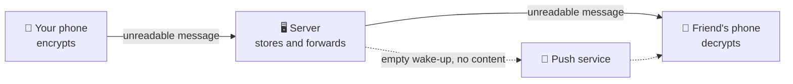

<div align="center">

# discord-lite

**Privacy-first chat, servers and social for gamers, on Android.**

End-to-end encrypted messages, Discord-style servers, stories and gaming posts,<br>
with no phone number and no contact upload.

[](https://github.com/Ripun-Build/discord-lite/actions/workflows/android.yml)
[](https://github.com/Ripun-Build/discord-lite/actions/workflows/server.yml)


[Features](#features) · [Privacy](#privacy) · [Roadmap](#roadmap) · [Run it locally](#run-it-locally) · [Project layout](#project-layout)

</div>

---

> [!NOTE]
> discord-lite is in active development and isn't on the Play Store yet. Phases 0 to 7 are finished. Reels are next.

## Features

| | What you get |
|---|---|
| 🔒 **Private messages** | 1:1 and group chats (up to 25 people), end-to-end encrypted with read receipts and typing indicators |
| 🎮 **Servers** | Text channels, categories, roles with permissions and @mentions |
| 🔗 **Invites** | Shareable links with live cards, expiry, use limits and bans |
| 📸 **Stories** | Photos for your friends that last 24 hours, then move to your private archive |
| 🕹️ **Gaming posts** | Up to 5 photos with a game tag, likes, comments with replies, and saved posts |
| 👥 **Followers** | Follow anyone, or make your account private and approve who follows you |
| 🔔 **Quiet notifications** | Push wake-ups that carry no message content |

## Privacy

Privacy shapes how the app is built, so it's worth being exact about what is protected.

| | End-to-end encrypted? | Who can see it |
|---|---|---|
| DMs and group chats | ✅ Yes | Only the people in the chat. The server can't read them. |
| Posts shared into a chat | ✅ Yes | The message is encrypted. The post itself keeps its own privacy. |
| Server channels | ❌ No | Members of that server |
| Stories | ❌ No | Your friends for 24 hours, then only you |
| Posts | ❌ No | Anyone signed in, or only your followers if your account is private |

- **Sign up with email only.** No phone number and no contact upload.
- **Photos are cleaned.** Every upload is re-saved so location and camera data never reach anyone.
- **Your phone is protected too.** The local database is encrypted, with optional app lock, and screenshots are blocked by default.
- **You decide who reaches you.** Choose who can DM you, and hide notification content.
- **Blocking is silent.** A blocked person sees the same "not found" as an account that doesn't exist.

## How messaging works



The server only ever handles encrypted messages. Push notifications are empty wake-ups: the phone fetches the message and decrypts it itself.

## Roadmap

| Phase | | Status |
|---|---|---|
| 0 | Project setup, design system and main screens | ✅ Done |
| 1 | Accounts, profiles, friends and blocks | ✅ Done |
| 2 | End-to-end encrypted DMs and push notifications | ✅ Done |
| 3 | Encrypted group chats | ✅ Done |
| 4 | Servers, channels, roles and @mentions | ✅ Done |
| 5 | Invite links, cards and bans | ✅ Done |
| 6 | Stories | ✅ Done |
| 7 | Gaming posts and followers | ✅ Done |
| 8 | Reels | ⏭️ Next |
| 9 | Polish and beta | 🗓️ Planned |

### Still not done, and coming soon

- [ ] **Unblocking:** you can block someone in the app, but there's no screen to unblock them yet.
- [ ] **Notifications** for follows, likes and comments. For now, follow requests only show on your Profile.
- [ ] **Reporting** posts, comments and accounts. Accounts are public by default, so this matters.
- [ ] **Share profile:** the button doesn't do anything yet.

## Tech stack

| | |
|---|---|
| **Android** | Kotlin, Jetpack Compose, SQLCipher, libsignal, Retrofit, OkHttp, Haze |
| **Server** | Kotlin, Ktor, PostgreSQL, Flyway, WebSockets |
| **Storage** | S3-compatible (SeaweedFS in development) |
| **Encryption** | Signal Protocol (PQXDH, Double Ratchet, Sender Keys) |
| **Push** | Firebase Cloud Messaging (content-free) |

## Run it locally

**You'll need:** JDK 25, Docker Desktop and Android Studio.

### 1. Start the server

```bash
cp .env.example .env        # then replace every "change-me" value
docker compose up -d --wait # Postgres :5432, Redis :6379, S3 :8333, Mailpit :8025 (localhost only)
cd server && ./gradlew run  # API on http://localhost:8080 (reads secrets from ../.env)
```

Check it's running:

```bash
curl localhost:8080/health
```

Verification and password-reset emails are caught by Mailpit. Read them at http://localhost:8025. Nothing goes to real inboxes in development.

### 2. Run the app

Open `android/` in Android Studio, or use the command line (needs a running emulator or a connected device):

```bash
cd android && ./gradlew :app:installDebug
```

The emulator reaches your local server at `http://10.0.2.2:8080`. A real phone plugged in over USB reaches it through a USB tunnel, which every debug build opens for you. If you unplug the phone and plug it back in without building again, open the tunnel yourself:

```bash
adb reverse tcp:8080 tcp:8080
```

Or, on a real phone on the same Wi-Fi, build with:

```bash
./gradlew :app:installDebug -PapiBaseUrl=http://<your-mac-ip>:8080/
```

### 3. Add a test friend

With the server running, start **@echobot**. It answers whatever you send, encrypted end to end with real Signal keys, just like a second phone:

```bash
cd server && ./gradlew echoBot
```

In the app, go to Friends, search `echobot`, tap Add (it accepts automatically), then Message.

<details>
<summary>More things to try with @echobot</summary>

- **Groups:** add it to a group (New message → New group) and it answers there too.
- **Servers:** add it to a server (Servers → Add friends) and @mention it in a channel to get a reply.
- **Invites:** DM it an invite link (`discordlite://invite/<code>`) and it joins that server.
- **Stories:** it posts a story each time it starts. Set `BOT_STORY=0` to skip that.
- **Push:** set `BOT_REPLY_DELAY_MS=8000`, send a message, then close the app to see the notification arrive.

</details>

### Run the tests

```bash
cd server && ./gradlew test
```

The server tests run against a real PostgreSQL database and use real Signal clients. The S3 storage test only runs when S3 keys are set in your environment.

## Project layout

```text
android/              Android app
  core/designsystem/  Theme, spring motion, glass and shared components
  app/                Screens, navigation, encryption and local storage
server/               Ktor backend
  src/main/           API, gateway, push and database migrations
  src/test/           Tests, plus the @echobot tool
docker-compose.yml    Local Postgres, Redis, S3 storage and Mailpit
.github/workflows/    Android and server builds
```
